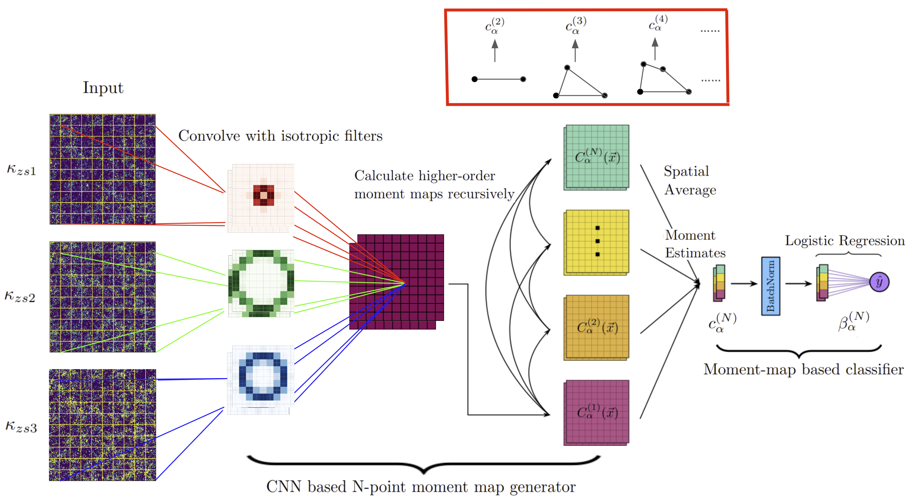

# Cosmological Convolutional Neural Network (C3NN)
We introduce the Cosmological Correlator Convolutional Neural Network (C3NN) for cosmological analyses, adapted from the model initially proposed by Miles et al. (2021) in studies of correlated quantum matter. The output of this model can be explicitly related via a one-to-one correspondence to different orders of cosmological N-point correlation functions (NPCFs). The codes shown here are used in the paper: https://iopscience.iop.org/article/10.3847/1538-4357/ad582e

The model architecture we used in the paper for the binary classification task is shown below  

It is composed of two parts. The first part comprises a CNN-based N-point moment map generator that outputs a series of statistics, which we call N-point moments and have an explicit mathematical connection to traditional NPCFs that we are familiar within cosmology. In this part of the model we first perform a single convolution on the input data and then without applying a nonlinear transformation as the usual practice, we construct moment maps directly from the initial convolved map through a recursive procedure. We adapt the filters of the convolution to be rotationally invariant (Cesa et al. 2022) such that the output remains stationary for arbitrary rotations of the input. This benefits the training data efficiency of our analyses and the interpretation of the trained filter weights. The second part of the model, which is a moment map-based classifier, exploits these output moment maps to perform classification tasks by passing them through consecutive layers of spatial averaging, batch normalization, and logistic regression. We optimize all hyperparameters of C3NN using the package Optuna.

The interpretability of C3NN mainly exists in the following three aspects: (i) the output moment of a specific order N can be mathematically expressed in terms of the correlation function at the same order. This is unlike the often hard-to-interpret summary statistics extracted by conventional CNN models, (ii) through a regularization path analysis (Efron et al. 2004; Tang et al. 2014), which is integrated into the classifier part of our model, we can have a quantitative understanding of the relative importance of the different order moments in contributing to the model’s classification power. Moreover, (iii) we can investigate the trained filter weights by connecting individual pixels to form the configuration of any given NPCF. The filter weights for a given NPCF configuration directly allow us to rank different correlation function configurations within a given moment.

For a demonstration of the above discussion, please refer to the notebook in the directory C3NN_binary_classification. Besides, here we also have some preliminary codes about replacing the classification part with an inference network and use C3NN as an inference model to work on some simulation-based inference (SBI) tasks.
