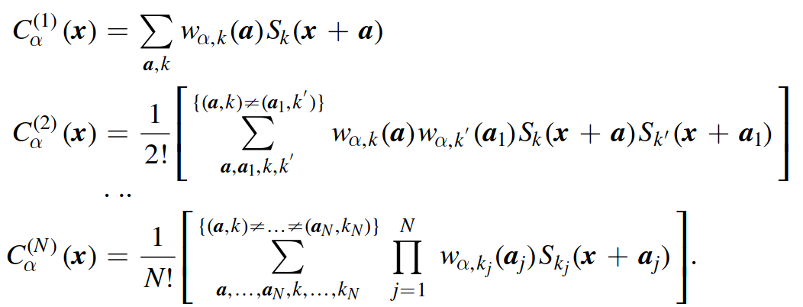

# Cosmological Convolutional Neural Network (C3NN)
We introduce the Cosmological Correlator Convolutional Neural Network (C3NN) for cosmological analyses, adapted from the model initially proposed by Miles et al. (2021) in studies of correlated quantum matter. The output of this model can be explicitly related via a one-to-one correspondence to different orders of cosmological N-point correlation functions (NPCFs). The codes shown here are used in the paper: https://iopscience.iop.org/article/10.3847/1538-4357/ad582e

The model architecture we used in the paper for the binary classification task is shown below  

CNN-based N-point moment map generator: The generator part of the architecture performs convolution operations recursively in order to produce moment maps, which we define as :

`$E = mc^2$`
